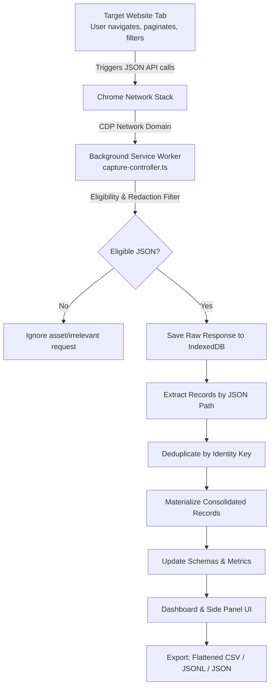

# Live Network Data Collector — User Guide & Platform Manual

This comprehensive guide explains how to install, configure, operate, and troubleshoot the **Live Network Data Collector** platform.

---

## Table of Contents

1. [Platform Overview & Core Concept](#1-platform-overview--core-concept)
2. [Prerequisites & Installation](#2-prerequisites--installation)
3. [The Two-Tab Browsing Workflow](#3-the-two-tab-browsing-workflow)
4. [Step-by-Step Tutorial: Your First Capture Session](#4-step-by-step-tutorial-your-first-capture-session)
5. [Collector Dashboard: Complete Feature Tour](#5-collector-dashboard-complete-feature-tour)
   - [Overview & Real-Time Metrics](#51-overview--real-time-metrics)
   - [Sources & Endpoint Groups](#52-sources--endpoint-groups)
   - [Raw Responses Inspector](#53-raw-responses-inspector)
   - [Consolidated Records Table](#54-consolidated-records-table)
   - [Schema Discovery & Conflict Detection](#55-schema-discovery--conflict-detection)
   - [Export Center (CSV, JSON, JSONL)](#56-export-center-csv-json-jsonl)
   - [Settings & Storage Retention](#57-settings--storage-retention)
6. [Using the Chrome Side Panel](#6-using-the-chrome-side-panel)
7. [Deduplication & Extraction Deep-Dive](#7-deduplication--extraction-deep-dive)
8. [Spreadsheet Formula Injection Defense](#8-spreadsheet-formula-injection-defense)
9. [Privacy, Permissions & Security Policy](#9-privacy-permissions--security-policy)
10. [Troubleshooting & Frequently Asked Questions](#10-troubleshooting--frequently-asked-questions)
11. [BandaGo POS to Sphere Pharmacy Live Synchronization](#11-bandago-pos-to-sphere-pharmacy-live-synchronization)

---

## 1. Platform Overview & Core Concept

The **Live Network Data Collector** is a local-first Chrome browser extension (Manifest V3) designed for developers, data engineers, researchers, and analysts.

### Why Use This Instead of Traditional Web Scrapers?

- **No Reverse Engineering Required:** You do not need to decipher session tokens, decode anti-bot fingerprints, or manually reconstruct complicated pagination requests.
- **Natural User Navigation:** You log in and navigate the target website in a normal browser tab. As you browse, paginate, filter, or scroll, the extension intercepts and records the underlying JSON API responses.
- **Accurate Accumulation:** Moving from Page 1 to Page 2 to Page 3 accumulates records continuously without overwriting previous data. Revisiting Page 1 updates records without creating duplicate items.
- **Local-First & Private:** All network payloads and records stay on your local computer in browser IndexedDB. No credentials, cookies, or passwords are saved or uploaded.

### Architecture Workflow Diagram



---

## 2. Prerequisites & Installation

### System Requirements

- Google Chrome version **118** or newer.
- Node.js version **18+** and npm (for building from source).

### Step 1: Build the Extension

From the root of the repository, execute:

```bash
# 1. Install dependencies
npm install

# 2. Run the test suite to verify module integrity
npm test

# 3. Build the production extension package
npm run build
```

This compiles TypeScript, packages Tailwind CSS, and outputs the complete unpacked extension into the [`dist/`](file:///home/elvin/Projects/tutorials/api-data-csv-extractor/dist) directory.

### Step 2: Load into Google Chrome

1. Open Google Chrome and enter `chrome://extensions/` in the address bar.
2. In the top-right corner, toggle on **Developer mode**.
3. In the top-left corner, click **Load unpacked**.
4. Browse to and select the `dist` folder located at:
   ```text
   /home/elvin/Projects/tutorials/api-data-csv-extractor/dist
   ```
5. You will see **Live Network Data Collector** listed with version `0.1.0`. Pin the extension to your Chrome toolbar for easy access.

---

## 3. The Two-Tab Browsing Workflow

The system is designed around two coordinated tabs in the same Chrome window:

```text
┌───────────────────────────────────────┐  ┌───────────────────────────────────────┐
│ TAB A: Target Website                 │  │ TAB B: Collector Dashboard            │
│ (e.g. Catalog, E-Commerce, Portal)    │  │ (chrome-extension://.../dashboard.html│
│                                       │  │                                       │
│  - User operates website normally     │  │  - Selects Tab A to monitor           │
│  - Handled: Logins, 2FA, Captchas     │  │  - Start / Pause / Stop controls      │
│  - User clicks: Next Page, Search     │  │  - Inspects raw JSON & schemas        │
│  - Emits normal fetch() / XHR         │  │  - Exports deduplicated CSV / JSONL   │
└───────────────────────────────────────┘  └───────────────────────────────────────┘
```

> [!IMPORTANT]
> The target website tab remains completely in your control. The collector never issues synthetic API requests on your behalf and never replays cookies. It simply observes responses that the site itself loads.

---

## 4. Step-by-Step Tutorial: Your First Capture Session

We provide an interactive **Demo Medication Catalog** built right into the project so you can verify the entire pipeline before testing on real websites.

### Step 1: Launch the Local Test Server

In your terminal, start the Vite development server:

```bash
npm run dev
```

This starts a local server (typically at `http://localhost:5173`) with live mock endpoints (`/api/medications`).

### Step 2: Open the Demo Catalog & Collector Dashboard

1. In Chrome, open a new tab and go to:
   ```text
   http://localhost:5173/demo.html
   ```
   You will see the **Demo Medication Catalog** displaying 50 items on Page 1.
2. Open the collector dashboard by either:
   - Clicking the **Live Network Data Collector** icon in Chrome's toolbar, or
   - Opening `chrome-extension://<EXTENSION_ID>/dashboard.html` in a second tab.

### Step 3: Attach the Collector to the Target Tab

1. On the collector dashboard toolbar, click the **Start Capture** button.
2. The **Select Browser Tab to Capture** modal will open:
   - You will see the list of open HTTP/HTTPS tabs.
   - Click on `Medication Catalog — Live API Demo Target` (`localhost`).
   - Click **Start Capture**.
3. The dashboard status badge will switch to a green, pulsing **Recording** indicator. Chrome may display a subtle header banner indicating that the debugger is attached to the tab.

### Step 4: Browse and Paginate on the Website

1. Switch to the **Demo Medication Catalog** tab.
2. Click **Next Page** (navigating from Page 1 to Page 2).
3. Click **Next Page** again (Page 2 to Page 3).
4. Now click **Previous Page** to go back to Page 1 (simulating a revisit).

### Step 5: Verify Accumulated Data in the Dashboard

Switch back to the **Collector Dashboard** tab:

1. **Overview Tab:**
   - **Responses Observed:** Shows `4` (Page 1, Page 2, Page 3, and revisit of Page 1).
   - **Unique Records:** Shows exactly `150` items.
2. **Records Tab:**
   - Browse the consolidated table. Notice that revisiting Page 1 did **not** inflate the record count to 200 items. Items 1–50 were recognized by their `id` and updated in place as Version 2.
3. **Exports Tab:**
   - Select **Flattened CSV**.
   - Check **Formula Injection Defense** and **UTF-8 BOM Header**.
   - Click **Download File** to save your structured dataset.

---

## 5. Collector Dashboard: Complete Feature Tour

The dashboard is structured into 7 primary views accessible via the top navigation bar.

### 5.1 Overview & Real-Time Metrics

The Overview tab provides a high-level operational cockpit:

| Metric                 | What It Represents                                                            |
| ---------------------- | ----------------------------------------------------------------------------- |
| **Responses Observed** | Total number of eligible JSON API responses detected on the wire.             |
| **Responses Saved**    | Number of raw HTTP response bodies successfully committed to IndexedDB.       |
| **Unique Records**     | Total number of materialized, deduplicated entities currently in the dataset. |
| **Endpoint Groups**    | Number of unique normalized API routes discovered (e.g. `/api/medications`).  |
| **Storage Used**       | Approximate local browser storage used by stored payloads.                    |
| **Capture Errors**     | Any body retrieval failures, network timeouts, or parse exceptions.           |

Below the metrics, the **Recent Event & Error Log** displays timestamped diagnostic notices if an endpoint failed to load or exceeded payload limits.

---

### 5.2 Sources & Endpoint Groups

Located under the **Sources** tab ([`src/dashboard/pages/Sources.tsx`](file:///home/elvin/Projects/tutorials/api-data-csv-extractor/src/dashboard/pages/Sources.tsx)):

- **Normalized Grouping:** Query strings like `?page=1` and `?page=2` are automatically stripped into a canonical endpoint (e.g. `https://example.com/api/medications`).
- **Include / Exclude Toggle:** If a website makes auxiliary API calls you do not want in your dataset (such as analytics or notifications), click the toggle to exclude that source.
- **Record Array JSON Path:** Configure which JSON property contains the array of items. By default, the engine tests common candidate paths:
  - `root` (top-level array `[{...}]`)
  - `data`
  - `results`
  - `items`
  - `data.items`
  - Custom dot paths (e.g. `response.payload.medicines`)
- **Identity Key Field:** Set which field uniquely identifies records (e.g. `id`, `sku`, `uuid`, `productId`, or `__hash__`).
- **Consolidation Policy:**
  - `Keep Latest` (Default): Newer incoming data replaces earlier versions of that entity and increments its version number.
  - `Keep First`: Preserves the first version observed and ignores subsequent duplicates.
  - `Keep All Versions`: Preserves every version under a distinct record key.
- **Reprocess Stored Responses:** Clicking this button re-runs all extraction and deduplication rules across already-captured raw response bodies without needing to reload the website.

---

### 5.3 Raw Responses Inspector

Located under the **Raw Responses** tab ([`src/dashboard/pages/Responses.tsx`](file:///home/elvin/Projects/tutorials/api-data-csv-extractor/src/dashboard/pages/Responses.tsx)):

- **Audit Trail:** Shows an immutable, append-only log of every captured HTTP response.
- **Metadata Columns:** Timestamp, HTTP Method (`GET`, `POST`), Status (`200 OK`), Captured URL, Size, and Parse Status (`Parsed`, `Invalid JSON`, `Excluded`).
- **Inspect JSON:** Click the **Inspect JSON** button on any row to open the built-in JSON viewer modal with one-click **Copy JSON** functionality.

---

### 5.4 Consolidated Records Table

Located under the **Consolidated Records** tab ([`src/dashboard/pages/Records.tsx`](file:///home/elvin/Projects/tutorials/api-data-csv-extractor/src/dashboard/pages/Records.tsx)):

- **Search:** Instant client-side search across all fields and identity keys.
- **Source Filter:** Filter the table to a specific API source or view all sources combined.
- **Dynamic Columns:** Automatically prioritizes primary keys (`id`, `name`, `price`) followed by nested dot-path columns (`strength.value`, `strength.unit`).
- **Pagination:** Clean page navigation (25 records per page).
- **Inspect & Provenance:** Click **Inspect** on any row to view its exact nested JSON, its materialized version number, and the exact `responseId` that generated it.

---

### 5.5 Schema Discovery & Conflict Detection

Located under the **Schemas** tab ([`src/dashboard/pages/Schemas.tsx`](file:///home/elvin/Projects/tutorials/api-data-csv-extractor/src/dashboard/pages/Schemas.tsx)):

- **Observed Field Paths:** Full list of dot-notation paths discovered in the records.
- **Type Detection:** Highlights observed primitive types (`string`, `number`, `boolean`, `array`, `object`, `null`).
- **Optionality Detection:** Flags fields that are only present in a subset of items as `Optional`.
- **Conflict Alerts:** Alerts you if an API exhibits schema drift—for example, if `price` appears as a `number` (`19.99`) on Page 1 but as a formatted `string` (`"$19.99"`) on Page 3.

---

### 5.6 Export Center (CSV, JSON, JSONL)

Located under the **Exports** tab ([`src/dashboard/pages/Exports.tsx`](file:///home/elvin/Projects/tutorials/api-data-csv-extractor/src/dashboard/pages/Exports.tsx)):

#### 1. Choose Your Export Format

- **Flattened CSV:** Converts nested objects into dot-path column headers (e.g. `dimensions.width`). Nested arrays are serialized to JSON strings. Ready for Excel, Google Sheets, or Python Pandas.
- **Raw CSV:** Exports metadata columns (`id`, `capturedAt`, `source`) alongside a single `raw_json` column.
- **JSON Lines (`.jsonl`):** Outputs one complete, unflattened JSON object per line. Recommended for streaming ETL jobs, Spark, BigQuery, and Elasticsearch.
- **Session JSON Bundle (`.json`):** Comprehensive hierarchical export containing session configuration, endpoint schemas, and all raw records.

#### 2. Configure Security & Output Options

- **Formula Injection Defense:** Enabled by default. Escapes dangerous leading characters (`=`, `+`, `-`, `@`) to protect against malicious spreadsheet formulas.
- **UTF-8 BOM Header:** Prepends the standard `\uFEFF` Byte Order Mark so Microsoft Excel opens international characters without character encoding errors.
- **Blank Empty Cells:** Formats missing or null properties as blank cells rather than literal `"null"` text.

#### 3. Live Preview & Download

The real-time preview panel displays the first 8 lines of the generated output and estimated filename. Click **Download File** to save the file to your computer.

---

### 5.7 Settings & Storage Retention

Located under the **Settings & Privacy** tab ([`src/dashboard/pages/Settings.tsx`](file:///home/elvin/Projects/tutorials/api-data-csv-extractor/src/dashboard/pages/Settings.tsx)):

- **Clear Consolidated Records:** Empties the materialized dataset while keeping your raw response history intact. You can alter extraction rules and reprocess at any time.
- **Delete Entire Session & Wipe Storage:** Permanently removes the session, raw responses, extracted records, and schemas from browser IndexedDB.
- **Sensitive Parameter Blocklist:** Displays query parameters that are automatically scrubbed (`access_token`, `auth_token`, `api_key`, `token`, `secret`, `password`, `code`, `jwt`).
- **Sensitive Endpoint Keywords:** Displays route keywords that are automatically blocked (`/login`, `/signin`, `/logout`, `/auth`, `/oauth`, `/password`, `/credentials`, `/token`).

---

## 6. Using the Chrome Side Panel

For long browsing sessions where you prefer not to switch tabs, use the **Chrome Side Panel**:

1. Click **Side Panel** in the top-right toolbar of the dashboard.
2. Chrome's side panel will open on the right edge of your browser window, running alongside your target website.
3. The side panel provides:
   - Target tab hostname and status badge.
   - Quick **Start**, **Pause**, **Resume**, and **Stop** buttons.
   - Live counters for responses captured and unique records found.
   - Recent endpoint activity stream.
   - A button to jump directly to the **Full Dashboard**.

---

## 7. Deduplication & Extraction Deep-Dive

### How Deduplication Works

When an API response finishes loading, items are parsed using the source's `recordPath`. For each item:

1. **Identity Key Lookup:**
   - The engine checks for a user-specified key (e.g. `sku`).
   - If unspecified, it searches common unique fields: `id`, `_id`, `uuid`, `productId`, `medicine_id`, `sku`, `code`.
   - If no candidate exists, it generates a canonical content hash `__hash__` using sorted JSON keys.
2. **Consolidation Check:**
   - If the identity key has not been seen before, the record is inserted as `version: 1`.
   - If the identity key already exists, the record is updated according to the source's policy:
     - `keep_latest`: Fields are refreshed with newer values and version increments (`version: 2`).
     - `keep_first`: New incoming data is ignored, preserving original values.
     - `keep_all`: An additional version record is saved.

---

## 8. Spreadsheet Formula Injection Defense

### The Threat (CSV Injection / CWE-1236)

When exporting data from public websites, text fields may inadvertently or maliciously begin with formula characters such as `=`, `+`, `-`, or `@`. When opened in Microsoft Excel, LibreOffice Calc, or Google Sheets, the spreadsheet software may execute these cells as active formulas or external DDE commands.

### The Collector's Defense

The export generator ([`src/export/sanitize.ts`](file:///home/elvin/Projects/tutorials/api-data-csv-extractor/src/export/sanitize.ts)) automatically inspects cell values:

```ts
// If a cell value begins with =, +, -, @, \t, or \r
'=SUM(A1:B10)'  -->  "'=SUM(A1:B10)"
'+12345'        -->  "'+12345"
'@HYPERLINK(...)' --> "'@HYPERLINK(...)"
```

By prefixing with an inert single quote (`'`), spreadsheet engines treat the cell strictly as literal text, completely neutralizing formula execution.

---

## 9. Privacy, Permissions & Security Policy

### Why Does the Extension Request the `debugger` Permission?

Chrome extensions cannot inspect HTTP response bodies from standard cross-origin tabs using normal web APIs. The `chrome.debugger` API allows the extension to attach to a **single, user-selected tab** using the Chrome DevTools Protocol (`Network.enable` and `Network.getResponseBody`).

### Privacy Guarantees

- **No Cookie or Password Access:** The extension never requests the `cookies` permission and never inspects password input fields.
- **Scoped Attachment:** The debugger attaches strictly to the tab you select. It does not monitor arbitrary browser windows or tabs.
- **Sensitive Parameter Redaction:** URL query strings containing session tokens, OAuth codes, or API keys are scrubbed before storage.
- **Zero Remote Telemetry:** The extension contains no external analytics, trackers, or cloud upload scripts. All data remains inside your browser's local IndexedDB database.

---

## 10. Troubleshooting & Frequently Asked Questions

### Q: Chrome shows an infobar saying "Live Network Data Collector started debugging this browser". Is that normal?

**Yes.** This is Chrome's standard security notification whenever an extension uses the `chrome.debugger` API. It reminds you that the selected tab's network traffic is being observed.

### Q: Why does the status show "Detached"?

A capture session will enter the `Detached` state if:

1. You close the target browser tab.
2. You open Chrome DevTools (F12) on the target tab (Chrome only permits one debugger client attached to a tab at a time).
3. You click "Cancel" on Chrome's debugging infobar.

**Solution:** Simply return to the collector dashboard and click **Start Capture** to reattach when you are ready.

### Q: My website loads data, but no responses appear in the dashboard.

Check the following:

1. **Scope:** Is the request coming from the same hostname you allowed when starting capture?
2. **Content-Type:** The collector monitors JSON payloads (`application/json`, `application/ld+json`, etc.). It automatically ignores HTML, CSS, images, and script assets.
3. **Excluded Endpoints:** Check the **Settings** tab to ensure the URL does not contain an excluded keyword (e.g. `/auth`, `/login`).
4. **Pause State:** Verify that the status badge is green (**Recording**) and not amber (**Paused**).

### Q: Can I run captures on multiple tabs simultaneously?

In the MVP release, the collector captures **one active tab at a time** to guarantee determinism, prevent session cross-contamination, and protect memory. To record a different tab, click **Stop** and start a new session targeting the other tab.

---

## 11. BandaGo POS to Sphere Pharmacy Live Synchronization

The platform includes a dedicated, zero-touch ingestion and synchronization engine designed specifically for pharmacies operating **BandaGo POS** (`go.bandahealth.org` - OSGi GraphQL on iDempiere ERP) alongside **Sphere Pharmacy** storefronts.

### Key Capabilities

1. **First-Expired, First-Out (FEFO) Stock Calculation:**
   - Evaluates multi-batch storage records (`storageOnHand` and `M_StorageOnHand`).
   - Automatically detects and discards expired batches relative to current UTC time.
   - Sums only legally sellable physical inventory units.
   - Ignores depleted batches (`qtyOnHand <= 0`) so they do not falsely skew the calculated `nearestExpiryDate`.
   - Materializes the nearest valid expiry date for display on Sphere Pharmacy storefronts.

2. **Kenya Pharmacy and Poisons Board (PPB) Prescription Scheduling:**
   - Automatically flags prescription-only medicines (POM) based on schedule keywords (`amoxicillin`, `ciprofloxacin`, `metronidazole`, `metformin`, `salbutamol`, `insulin`, `artemether`, etc.).
   - Honors category prescription flags and BandaGo's `bh_hasexpiration` indicators.
   - Automatically maps categories to standard Sphere slugs (`cold-flu`, `heart-health`, `pain-fever`, `diabetes`, `first-aid`, `antibiotic`, `vitamins`).

3. **Offline Sync Ledger & In-Flight Race-Condition Protection:**
   - Changes are saved to an IndexedDB outbound queue (`sync_queue`) with status tracking (`PENDING`, `SYNCING`, `FAILED`).
   - If network connectivity drops, items remain securely buffered locally.
   - Failed items increment retry counters with exponential backoff (up to 5 retries).
   - In-flight safety: If fresh inventory arrives while an item is actively syncing, the item is preserved in `PENDING` status rather than being deleted upon HTTP 200 completion, ensuring the latest stock delta is always dispatched.

4. **Background Catalog Poller:**
   - Uses Chrome's `alarms` API to execute periodic catalog checks every 10 minutes.
   - Safely executes queries inside the pharmacist's authenticated `go.bandahealth.org` tab context via `chrome.scripting`.
   - Also triggers automatic queue flushing whenever the alarm fires to drain offline backlogs.

### Configuration in Settings

1. Open the dashboard and navigate to **Settings**.
2. Under **Sphere Pharmacy Live Sync (BandaGo Bridge)**:
   - **Sphere Ingestion Endpoint URL:** Enter the full destination URL (e.g., `https://your-pharmacy-store.com/api/integrations/bandago/sync` or local test `http://localhost:5173/api/integrations/bandago/sync`).
   - **Sync API Key:** Enter your Bearer secret key (configured as `BANDAGO_SYNC_API_KEY` on your Sphere Pharmacy server).
   - **Auto Sync:** Toggle **ON**.
   - **Test Handshake:** Click to verify API connectivity and authentication.
   - **Flush Pending:** Manually dispatch any pending offline queue items.
   - **Poll Active BandaGo Tab:** Manually trigger an immediate catalog query on any open BandaGo tab.

---

## Summary of Useful Commands

| Task                           | Command           |
| ------------------------------ | ----------------- |
| Run Unit Tests                 | `npm test`        |
| Start Dev Server & Demo Target | `npm run dev`     |
| Build Unpacked Extension       | `npm run build`   |
| Preview Production Build       | `npm run preview` |
