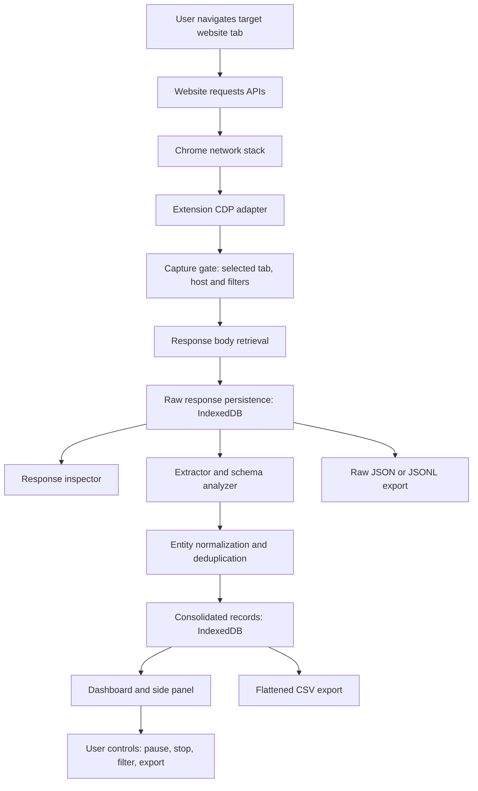

# Live Network Data Collector

**Product Requirements Document (PRD), Technical Architecture, and Implementation Blueprint**

| Field | Value |
|---|---|
| Product | Live Network Data Collector (working name) |
| Document version | 1.0 |
| Prepared | 22 October 2026 |
| Primary platform | Google Chrome, Manifest V3 extension |
| Suggested stack | TypeScript, React, Vite, Tailwind CSS, IndexedDB, Chrome DevTools Protocol |
| Deployment model | Local-first browser extension; optional cloud sync later |
| Intended users | Developers, data analysts, researchers, and authorized operators |
| Primary use case | Capture JSON API responses generated while a user browses a website and export the accumulated data |

> **Central design principle:** The user controls the website in a normal browser tab. The extension observes the selected tab's permitted network responses, stores them incrementally, and lets the user inspect and export the accumulated data. No separate browser profile, copied session cookies, or manual export between pages is required.

---

## 1. Executive Summary

Build a browser extension that runs alongside an existing website in the **same Chrome browser window**. The website remains in its own tab, where the user navigates, authenticates normally, searches, filters, scrolls, and changes pages. The extension supplies a **collector dashboard tab** and, optionally, a **Chrome side panel**.

When the user explicitly starts a capture session for a selected browser tab, the extension observes network events. When eligible JSON API responses finish loading, it retrieves their response bodies, preserves them with useful metadata, and extracts structured records into an accumulating dataset. These records remain saved when the user changes pages, revisits earlier pages, refreshes the target website, switches between tabs, or refreshes the collector dashboard.

The user can filter which endpoints are included, inspect original JSON, review inferred schemas, deduplicate records, and export the results to JSON, JSONL, or CSV. The default implementation is **local-first**: raw responses and extracted records stay on the user's device unless the user explicitly exports or enables an optional future synchronization feature.

### What this product solves

Many web applications expose data through APIs, but it is inconvenient to discover endpoint URLs, learn request parameters, manually page through results, reproduce authenticated calls, or consolidate responses without accidental duplication. This tool makes the **user's actual browsing actions the source of truth**.

Example: A user navigates a medication catalog that displays 50 items per page. After enabling capture, they visit pages 1, 2, 3, and so on. The extension observes the API responses triggered by those actions, stores all captured response bodies, extracts medication records, and increases the dataset count as more pages load. Revisiting page 1 should not inflate the **unique medication** count, although it may create a new entry in the raw response history.

### Important limitation

The product captures **responses observed after recording begins**. It cannot guarantee discovery of every server endpoint, every database record, or data the browser never requested. If an API only returns summary records, the collector cannot invent missing detail fields. Collection must be limited to data the user is authorized to access and export.

---

## 2. Goals, Non-goals, and Success Criteria

### 2.1 Goals

1. Monitor JSON API responses generated by a user-selected tab in real time or near real time.
2. Let the user continue operating the target website normally.
3. Work with public and already-authenticated browsing sessions **without extracting credentials**.
4. Capture data across route changes, pagination, search, filtering, and infinite scrolling.
5. Append new responses and consolidate records **without overwriting earlier pages**.
6. Preserve the original response body in addition to any flattened records.
7. Make multiple API response shapes understandable through schema inference and configurable extraction rules.
8. Provide clear controls: Start, Pause, Resume, Stop, Clear, Inspect, Select Sources, and Export.
9. Retain data across collector UI reloads and unexpected extension service-worker restarts.
10. Support reliable CSV export and loss-minimizing JSON/JSONL export.
11. Explain permissions and prevent accidental recording of unnecessary sensitive data.
12. Deliver a useful MVP without a backend server.

### 2.2 Non-goals for MVP

- Automatically discovering **all** hidden endpoints on a website or crawling entire websites without user interaction.
- Bypassing login, paywalls, CAPTCHA, access controls, rate limits, or site protections.
- Replaying authenticated requests, harvesting credentials, or duplicating cookies/tokens.
- Capturing arbitrary traffic from **every** open tab by default.
- Guaranteeing 100% network coverage when the browser, DevTools, service workers, caching, or other debugger clients prevent capture.
- Parsing all binary protocols, WebSocket frames, streaming APIs, or embedded page state in version 1.
- Sending captured data to a remote backend without an explicit user decision.
- Treating HTML rendered on screen as equivalent to an accessible API response.

### 2.3 Measurable MVP acceptance criteria

- A user selects a target tab and explicitly starts capture.
- A new JSON API response is recorded and becomes visible in the collector shortly after completion.
- Visiting three different medication pages with 50 distinct items each produces **150 unique items** if the responses genuinely contain those items and IDs are consistent.
- Revisiting page 1 adds an additional raw capture but does **not** create 50 duplicate unique medications.
- Refreshing the collector tab preserves previously captured responses and records.
- Pausing capture prevents new responses from being saved; resuming records subsequent responses.
- A mixed response (`data.items`, `results`, top-level array) can be previewed and configured for record extraction.
- JSON/JSONL export preserves nested objects and arrays; CSV export encodes or flattens them according to an explicit setting.
- A user can delete an individual session, wipe its local data, and detach from the target tab.
- A stopped or detached capture does not leave the tool claiming it is still recording.
- Failures appear in a visible error/event log instead of silently marking requests successful.

---

## 3. Core User Experience

### 3.1 The two-tab workflow

**Tab A: Target website**

- The user opens the website normally, either before or after opening the collector.
- Authentication remains managed by the website/browser.
- The user performs any allowed navigation: pagination, search, filter changes, opening details, scrolling, etc.
- The website emits the same requests it would have emitted without the extension.

**Tab B: Collector dashboard**

- The user selects the tab to watch (by tab title and hostname), instead of assuming a typed URL identifies a particular tab.
- The user can optionally enter a URL and choose **Open Website in New Tab**, after which that tab becomes the selected target.
- The dashboard displays network activity, endpoint groups, raw responses, extracted records, storage usage, and export actions.
- The dashboard can stay open or in the background; capturing does not depend on keeping its React component mounted.

**Optional side panel**

- Provides lightweight controls beside the website: recording state, response count, unique record count, recent endpoints, Start/Pause/Stop, and Open Full Dashboard.
- Must make the currently targeted tab and hostname obvious, particularly if the user switches tabs.

### 3.2 First-time setup flow

1. Install the extension and open the collector dashboard.
2. See a plain-language explanation of the powerful `debugger` permission and data sensitivity.
3. Select an open HTTP(S) website tab or open a chosen URL.
4. Specify the allowed site/host scope and initial capture filters.
5. Choose **Start Capture**.
6. Extension attaches to the selected tab and enables CDP network monitoring.
7. Collector shows **Recording** only after attachment and network enablement succeed.
8. User returns to the website and performs actions.
9. Results accumulate in the collector; optional notifications signal errors or new sources.
10. User stops capture and exports or saves the local session.

### 3.3 Primary controls and exact semantics

| Control | Expected behavior |
|---|---|
| Start Capture | Attach to selected tab, enable network observation, persist a session, show permission/attach errors clearly |
| Pause | Do not persist new captured responses while paused; the website continues normally |
| Resume | Capture **new** network responses from that point forward; do not claim missed requests were recovered |
| Stop | Disable monitoring/detach, finalize session metadata, retain saved data |
| Clear View | Reset UI filters only, **not** stored data |
| Clear Dataset | Remove consolidated records after explicit confirmation; raw history remains unless separately cleared |
| Delete Session | Remove this session's responses, records, schemas, settings, and metadata with confirmation |
| Refresh Dashboard | Re-read IndexedDB; preserve data and accurately restore capture status |
| Refresh Target Website | User-triggered reload; subsequent requests may be captured as additional responses |
| Export | Download selected session/endpoint/dataset in configured format |

### 3.4 User-visible metrics

Keep these metrics distinct because they are **not interchangeable**:

- **Responses observed:** eligible network responses seen by the monitor.
- **Responses saved:** response bodies successfully persisted.
- **Capture errors:** responses whose body could not be retrieved, parsed, or saved.
- **Parsed records:** all records extracted, including duplicates and later revisions.
- **Unique records:** number of entities currently represented in the consolidated dataset.
- **Endpoint groups:** distinct normalized sources (not just hostnames).
- **Bytes stored:** approximate local usage; warn before storage limits are reached.
- **Collection coverage:** only something the tool can justify (e.g., “12 pages observed”), never a fabricated “12 of 100 pages” unless the source response explicitly establishes the total.

---

## 4. Recommended Technical Stack

| Layer | Choice | Reason |
|---|---|---|
| Browser integration | Chrome Extension Manifest V3 | Direct browser tab integration |
| Network capture | `chrome.debugger` + Chrome DevTools Protocol (CDP) | Can attach to selected tabs and retrieve supported response bodies |
| Lightweight UI | Chrome Side Panel API | Live controls alongside the website |
| Full UI | React + TypeScript + Vite + Tailwind CSS | Familiar, maintainable dashboard; no external website required |
| Extension worker | Manifest V3 service worker | Event-driven capture controller |
| Local persistence | IndexedDB (via Dexie or idb) | Indexed records, large local datasets, transactions |
| Small settings | `chrome.storage.local` | Session preferences, flags, light metadata |
| Data shape validation | Zod | Validate internal messages/settings and parsed metadata |
| JSON transformation | TypeScript utilities | Extraction, flattening, schema inference, deduplication |
| Download/export | Browser Blob/Object URL and/or `chrome.downloads` | User-triggered local downloads |
| Testing | Vitest + Playwright + extension-specific integration tests | Unit, E2E and browser behavior |

**Do not build the core as a regular remotely hosted Next.js page.** A normal website in another tab cannot simply read cross-origin network bodies from its neighbor. The actual capture engine must run with extension privileges. A conventional website may be added later for documentation, subscriptions, or optional cloud features.

### 4.1 Minimum browser version

Set `minimum_chrome_version` to at least `118` for the MVP. Chrome documentation states that active `chrome.debugger` sessions keep MV3 service workers alive starting in Chrome 118. Still persist data promptly and recover from unexpected shutdowns; a running debugger session is not a guarantee against crashes or forced detachments.

### 4.2 Alternative capture mechanism

A DevTools extension can use `chrome.devtools.network` and request `getContent()` for network entries, but its workflow depends on the DevTools environment. It is a **secondary** approach rather than the principal implementation for this product. The debugger API fits the proposed user-controlled website tab plus separate collector dashboard more directly.

---

## 5. Architecture



### 5.1 Modules and ownership

**A. Tab/session manager**
- Presents an explicit browser-tab picker.
- Tracks selected `tabId`, starting URL/hostname, session ID, recording status, timestamps, and allowed host scope.
- Handles tab close, debugger detach, browser restart and target changes.
- Supports one targeted tab at a time in MVP; multi-tab capture can be a later feature.

**B. Capture controller**
- Initiates and terminates `chrome.debugger` attachment.
- Runs `Network.enable` after attachment.
- Handles `chrome.debugger.onEvent` and `chrome.debugger.onDetach`.
- Associates requests with their selected tab and unique request IDs.
- Correlates response receipt with loading completion.
- Limits concurrent body reads, memory use and allowed payload size.

**C. Source filter and policy engine**
- Allows only requests associated with selected tab/session and approved target scope.
- Defaults to capturing JSON responses associated with `XHR` or `Fetch`, with configurable options.
- Offers include/exclude URL patterns and per-endpoint toggles.
- Allows users to omit login, session, token, account and other sensitive endpoints.
- Handles GraphQL operations and repeated shared endpoints in later phases.

**D. Raw-response store**
- Saves original response body text (or the CDP-decoded equivalent) and metadata.
- Is append-only within a session by default: every successfully captured response gets an event entry, including repeated requests.
- Saves before attempting schema inference to avoid losing unusual response structures.
- Never stores request cookies, `Authorization` headers, bearer tokens, or passwords.

**E. Record extraction and schema engine**
- Detects top-level arrays, `data`, `results`, `items`, `data.items`, `data.results` and selected user-configured JSON paths.
- Shows a preview before treating an object as the record collection.
- Preserves nested objects/arrays and detects observed field types.
- Emits distinct record entities and extraction warnings.

**F. Deduplication engine**
- Uses a configurable identity key, e.g. `id`, `uuid`, `productId`, `medicine_id`, or a composite path.
- Allows a user to inspect and change identity rules per source.
- Uses stable hashes as a fallback only when no trustworthy identity key exists; content hashes identify identical content, **not necessarily the same logical entity**.
- Keeps raw historical captures separate from current consolidated record state.

**G. UI and export module**
- Shows detailed activity without blocking site browsing.
- Supports endpoint filtering, table previews, schema inspection, source counts, and error review.
- Exports either original JSON, JSONL, or explicit CSV transformations.

---

## 6. Chrome Integration and Event Lifecycle

### 6.1 Minimal example manifest

Illustrative `manifest.json` (build paths must match actual Vite output):

```json
{
  "manifest_version": 3,
  "name": "Live Network Data Collector",
  "description": "Capture permitted JSON responses from a user-selected tab and export them locally.",
  "version": "0.1.0",
  "minimum_chrome_version": "118",
  "permissions": ["debugger", "tabs", "storage", "sidePanel", "downloads"],
  "background": {
    "service_worker": "background.js",
    "type": "module"
  },
  "side_panel": {
    "default_path": "sidepanel.html"
  },
  "action": {
    "default_title": "Live Network Data Collector"
  }
}
```

**Notes:** `debugger` is a powerful permission and displays a warning. Limit use to a user-selected tab and describe it plainly during onboarding. Verify exactly which optional permissions the implementation really needs before release. A `tabs` permission provides tab metadata, so treat tab information as sensitive. Do **not** request cookie access merely to determine whether someone is logged in.

### 6.2 Capture initiation pseudocode

```ts
async function startCapture(tabId: number, sessionId: string) {
  // Preconditions: direct user action, allowed website, no conflicting capture.
  const target = { tabId };

  await chrome.debugger.attach(target, '1.3');

  try {
    await chrome.debugger.sendCommand(target, 'Network.enable', {
      maxTotalBufferSize: 100_000_000,
      maxResourceBufferSize: 10_000_000
    });

    await markSessionRecording(sessionId, tabId);
  } catch (error) {
    await chrome.debugger.detach(target).catch(() => {});
    throw error;
  }
}
```

These buffer values are **illustrative starting points**, not guaranteed platform capacities or safe production defaults. Test on representative sites, and do not assume increasing a buffer eliminates all body retrieval failures.

### 6.3 Network capture event sequence

1. `Network.responseReceived` indicates a response and reports its URL, MIME type, resource type and status.
2. Reject obviously irrelevant types (images, scripts, CSS, fonts), disallowed hosts and excluded paths.
3. Store lightweight pending metadata keyed by **debugger target/session + requestId**.
4. `Network.loadingFinished` signals that a request completed.
5. If its metadata remains eligible and the session is actively recording, call `Network.getResponseBody` using that request ID.
6. Handle a plain string or base64-encoded response body.
7. Check body-size limits and parse JSON safely.
8. Persist the raw capture and a capture status record.
9. Extract records and update materialized unique-entity views.
10. Update dashboard counters through extension messaging or IndexedDB change notification.
11. On `Network.loadingFailed`, mark eligible pending requests as failed, then clean up pending state.
12. On `chrome.debugger.onDetach`, update status immediately and explain why recording ended when possible.

**Implementation caution:** Register event listeners at the top level of the MV3 service worker. Do not rely on component-scoped React listeners or process-global maps for durable session state. In-flight network bookkeeping may exist in memory, but saved session metadata and completed captures belong in persistent storage. Test redirects, closed tabs, cached responses, frame requests and debugger conflicts.

### 6.4 Capture pipeline pseudocode

```ts
// Illustrative architecture, not a copy-paste complete implementation.
async function onEligibleResponseFinished(context: {
  tabId: number;
  requestId: string;
  sessionId: string;
  url: string;
  resourceType: string;
  mimeType: string;
  httpStatus: number;
}) {
  const result = await chrome.debugger.sendCommand(
    { tabId: context.tabId },
    'Network.getResponseBody',
    { requestId: context.requestId }
  ) as { body: string; base64Encoded: boolean };

  const text = result.base64Encoded
    ? new TextDecoder().decode(
        Uint8Array.from(atob(result.body), character => character.charCodeAt(0))
      )
    : result.body;

  const parsed = JSON.parse(text);

  // Transactionally save raw capture and extraction work queue item.
  const responseId = await saveRawCapture({ ...context, body: text });
  await queueExtraction({ responseId, parsed });
}
```

A production implementation should account for text encoding, large payload limits, base64 decoding cost, storage quotas, JSON parse errors, and body retrieval failures. CDP-provided response content is **not necessarily byte-for-byte identical to compressed HTTP wire bytes**; preserve the body returned by CDP without claiming to preserve transport compression or raw packets.

### 6.5 Browsing and authentication model

- Existing website login stays managed by the website and browser.
- Do not read passwords, cookies, local-storage authentication tokens or session secrets to initiate capture.
- The collector does **not** issue additional authenticated API requests in the MVP.
- The user decides which sites, endpoints, sessions, and datasets to include.
- Denied or inaccessible response bodies are marked unavailable.
- Never attempt to bypass account restrictions or retry unauthorized requests using stolen or copied credentials.

---

## 7. Data Model

Use IndexedDB with explicit object stores and useful indexes. The model below is a recommended design, not a requirement to copy field names exactly.

### 7.1 `capture_sessions`

```ts
type CaptureSession = {
  id: string;
  label: string;
  targetTabId: number | null;
  originalUrl: string;
  allowedHostnames: string[];
  status: 'idle' | 'starting' | 'recording' | 'paused' | 'stopped' | 'detached' | 'error';
  startedAt: string;
  endedAt?: string;
  lastResponseAt?: string;
  extractionSettingsId: string;
};
```

Store a session independently from a tab. Browser tab IDs are not durable identifiers across restarts; a historical session may have `targetTabId: null` when capture is no longer attached.

### 7.2 `raw_responses`

```ts
type RawResponse = {
  id: string;                   // local generated UUID
  sessionId: string;
  capturedAt: string;
  url: string;                  // redact sensitive query parameters before persistence
  normalizedEndpoint: string;
  httpStatus: number;
  resourceType: string;
  mimeType: string;
  responseBody: string;         // actual captured response text
  parseStatus: 'pending' | 'parsed' | 'invalid_json' | 'excluded' | 'failed';
  responseBytes: number;
  contentHash?: string;
  operationName?: string;        // GraphQL extension, if user enabled it
};
```

Do not persist authorization headers. Consider minimizing or sanitizing URLs with potentially sensitive query strings, such as `access_token`, `code`, `email`, or session keys. Captured **response bodies themselves** can contain sensitive data, and therefore need exclusion and retention controls.

### 7.3 `extracted_records`

```ts
type ExtractedRecord = {
  id: string;                 // internal stable row key
  sessionId: string;
  sourceId: string;           // endpoint + extraction rule
  identityKey: string;        // source-specific logical ID or fallback
  extractedAt: string;
  latestResponseId: string;
  rawRecord: unknown;         // source's nested record, unflattened
  normalizedFields?: Record<string, unknown>;
  version: number;
};
```

Enforce an IndexedDB unique key or transactionally checked compound key for `(sessionId, sourceId, identityKey)`. This prevents race conditions from concurrent response processing. Preserve provenance back to the raw response; if record history is required, use a separate `record_versions` store.

### 7.4 Additional stores

| Store | Purpose | Important indexes |
|---|---|---|
| `sources` | Per-endpoint include/exclude, extraction path, ID selection | `sessionId`, `normalizedEndpoint` |
| `capture_errors` | Body retrieval/parse/storage/export failures | `sessionId`, `timestamp`, `kind` |
| `record_versions` (optional) | History when an entity is updated | `recordId`, `capturedAt` |
| `extraction_jobs` | Pending/failed response parsing | `status`, `sessionId`, `createdAt` |
| `settings` | Global UI/export/security preferences | `key` |

### 7.5 Data-preservation guarantees

There are **two different retention policies**:

- **Raw response log:** Append successful capture events. If page 1 is loaded twice, two raw capture events may exist.
- **Consolidated records:** Upsert one logical row per unique entity key, so page revisits do not inflate unique counts.

Never silently replace a raw response with the next response. Do not couple local persistence to whether the dashboard tab is currently visible.

---

## 8. Handling Pagination and User Actions

### 8.1 The preferred model: observe, do not replay

**Example workflow**

- Page 1 requests `GET /api/medications?page=1` → receives 50 items → 50 unique records.
- Page 2 requests `GET /api/medications?page=2` → receives 50 items → 100 unique records.
- Page 3 requests the **same endpoint URL** but with a POST request body containing a cursor → receives 50 items → 150 unique records.
- Page 1 is revisited → another raw response saved; 150 unique records remain, assuming duplicate IDs.
- User changes a search filter → capture a new response, associate it with a distinguishable query/source context where available.

The collector does not need to predict pagination formats when the user is manually navigating. This is the main advantage over a standalone API fetcher.

### 8.2 Pagination and response patterns to test

| Pattern | Example | Expected collector behavior |
|---|---|---|
| Page number | `?page=2` | Capture new response and append/upsert extracted records |
| Offset/limit | `?offset=100&limit=50` | Same |
| Cursor | `?cursor=...` | Same, even when values are opaque |
| POST pagination | Same URL, different JSON body | Distinguish requests when appropriate; never need to replay |
| Infinite scroll | Background fetch when scrolling | Capture incremental batches |
| Search/filter | `?q=...&category=...` | Preserve filter context when useful; do not confuse different entity types |
| GraphQL | Same `/graphql`, different operation | In later phase, optionally group by operation name, without saving secrets |
| Client-side page switch | No network request | Correctly show **no new response captured** |
| Cached page or service-worker response | No new eligible body available | Explain missing/incomplete capture, never synthesize a record |
| Detail view | `GET /medications/:id` | Optionally merge extra fields with list records using same stable ID |

### 8.3 Completeness and refresh behavior

- The **Refresh Dashboard** control refreshes only displayed data.
- A **Reload Website** action should be explicit and should not automatically clear records.
- A **Reprocess Raw Data** action re-runs extraction rules from saved raw responses without making network requests.
- A **Recapture** mode may guide the user to revisit pages where retrieval failed; it must not imply automatic completeness.
- If an API returns `totalItems`, `pageCount`, or `hasNextPage`, display that metadata as **reported by the server**, not as a collector guarantee.

---

## 9. Data Extraction, Source Identification, and Schema Discovery

### 9.1 Source grouping

Use a source key derived from:

- URL origin and normalized path;
- HTTP method, when available without persisting sensitive request bodies;
- optional GraphQL operation name or user-defined group;
- response shape/extraction rule version.

Do **not** group unrelated operations simply because they share `/graphql`. Conversely, do not create thousands of separate source groups just because `page=1`, `page=2`, and `page=3` have different query strings. Preserve the original URL separately for provenance (after appropriate redaction).

### 9.2 Response shapes

Support common structures:

```json
[{"id": 1}, {"id": 2}]
```

```json
{"data": [{"id": 1}, {"id": 2}], "total": 100}
```

```json
{"data": {"items": [{"id": 1}, {"id": 2}], "nextCursor": "abc"}}
```

```json
{"results": [{"id": 1}, {"id": 2}], "pagination": {"page": 1}}
```

```json
{"data": {"medications": {"nodes": [{"id": 1}, {"id": 2}]}}}
```

Record path choices may be `root`, `data`, `results`, `data.items`, or `data.medications.nodes`. If there is more than one possible collection, present a selector with counts and a sample row rather than silently assuming.

### 9.3 Field extraction and schema inference

- Track observed field paths and observed value types (`string`, `number`, `boolean`, `null`, `object`, `array`).
- Mark fields optional when they are absent in some records.
- Flag type conflicts, such as `price` appearing as both `string` and `number`.
- Retain unknown keys and new fields instead of dropping them.
- Support user-selected columns, renaming, JSON-path selection, and field exclusion.
- Make transformations reproducible by storing extraction rule version and source response IDs.

### 9.4 Deduplication options

1. **Primary ID:** `id` or another explicit user-selected field.
2. **Composite key:** `manufacturer + sku + strength` or similarly stable domain-specific identifiers.
3. **Canonical content hash:** Fallback for exact repeated payloads; not safe to infer logical identity across changed records.
4. **No deduplication:** Keep every extracted row with its provenance.

Provide **Keep First**, **Keep Latest**, and **Keep All Versions** as explicit consolidation policies. Keep raw response history independent of these policies.

---

## 10. Export Design

### 10.1 Supported formats

| Export format | Purpose | Nested data behavior |
|---|---|---|
| Original response JSON | Inspect an individual response | Preserved as captured JSON text |
| Session JSON bundle | Export structured session metadata and captured responses | Fully nested structure |
| JSONL | Process many records in streaming tools | One JSON object per line, nested values preserved |
| Raw CSV | Metadata columns plus one `raw_json` column | Nested objects kept as JSON string |
| Flattened CSV | Spreadsheet/ETL-compatible dataset | Dot-path columns and arrays serialized or separately normalized |
| ZIP archive (later) | Download multiple endpoint exports and a manifest | Can include both raw and flattened files |

### 10.2 CSV flattening example

Input:

```json
{
  "id": "med-123",
  "name": "Paracetamol",
  "strength": {"value": 500, "unit": "mg"},
  "categories": ["analgesic", "antipyretic"]
}
```

Flattened columns:

```csv
id,name,strength.value,strength.unit,categories
med-123,Paracetamol,500,mg,"[""analgesic"",""antipyretic""]"
```

CSV has no standard native nested-object type. Serialize arrays as JSON strings by default and make relational child-table export an advanced setting. Export a separate CSV per source/schema by default to avoid mixing unrelated columns across `users`, `medications`, `orders`, etc.

### 10.3 CSV correctness and security

- Encode output as UTF-8 and offer a BOM option for spreadsheet compatibility.
- Escape quotes by doubling them; quote any value containing comma, quote, or newline.
- Use a deterministic set of columns computed from the selected dataset.
- Preserve `null` semantics through an export option (e.g., blank cell vs literal `null`).
- Defend against **spreadsheet formula injection**: fields beginning with spreadsheet formula indicators such as `=`, `+`, `-`, `@`, or leading whitespace/control characters followed by those indicators must be encoded as inert text for target spreadsheet applications. CSV quoting **alone is not a formula-injection defense**. Document which escaping method is used and test in spreadsheet software.
- Avoid creating one enormous in-memory string when datasets become large; prefer chunked/streamed assembly through a suitable export context and use bounded memory.
- Show a preview of selected source, row count, column list, and whether nested values will be serialized.

### 10.4 Export file naming

Suggested pattern:

`collector_<site>_<source>_<YYYY-MM-DD_HH-mm-ss>.<ext>`

Example:

`collector_pharmacy_medications_2026-10-22_14-30-00.csv`

Sanitize filename parts and avoid leaking sensitive query parameters or patient/customer identifiers into filenames.

---

## 11. UI/UX Requirements

### 11.1 Collector dashboard navigation

1. **Overview** — current session, chosen tab, recording state, counts, last activity, recent errors.
2. **Sources** — observed endpoints, response counts, extraction paths, include/exclude toggles.
3. **Responses** — a chronological raw response inspector with URL, status, timestamp, JSON tree, payload size and search.
4. **Records** — searchable consolidated table; source selection, field selection, duplicate status, pagination or virtualization.
5. **Schemas** — inferred field paths, optionality, type conflicts, extraction rule mapping, identity key configuration.
6. **Exports** — format, source scope, flattening strategy, preview, download.
7. **Settings & Privacy** — target restrictions, payload limits, retention, endpoint blocklist, erase session, default export behavior.

### 11.2 Layout and interaction principles

- Use a strong visual distinction between tabs/filters and buttons/actions.
- Do not use a giant hero section in a tool people use repeatedly.
- Put **Start/Pause/Stop** in a stable, easy-to-reach toolbar.
- Label the target tab and hostname prominently so users never accidentally record the wrong site.
- Use searchable, keyboard-accessible endpoint and field selectors.
- Use a virtualized table or server-like IndexedDB paging for large record collections.
- Provide meaningful empty states such as “No eligible JSON response yet — interact with the target site or reload a permitted page.”
- Do not jump the interface to new rows while the user is inspecting one; offer a “new responses” indicator.
- Show detailed source context for each table row: where and when it was captured.
- Support dark and light themes, responsive layouts and clear focus indicators.
- Avoid assuming all JSON responses are lists; inspect them before adding records.

### 11.3 Required status states

- **Idle** — no active capture.
- **Connecting** — debugger attach/network enable in progress.
- **Recording** — attached and eligible responses are being processed.
- **Paused** — attached or otherwise configured but collection suppressed.
- **Stopped** — intentionally ended; local results retained.
- **Detached** — debugger disconnected or tab closed; needs user action to restart.
- **Error** — start or processing failure, with actionable diagnostic.

---

## 12. Privacy, Security, and Permission Boundaries

### 12.1 Privacy by design

- Explicit user action required before attaching to a tab.
- Display which tab, site and sources are included.
- Restrict capture to authorized workflows and approved hostnames.
- Do not silently enable “record every tab” modes.
- Never read or export authentication cookies, password fields, token stores or request authorization headers.
- Exclude sensitive authentication endpoint responses by default where identifiable; support user-defined exclusions.
- Redact secrets from URLs and diagnostic logs.
- Default to no telemetry and no network upload of captured payloads.
- Provide simple local deletion and retention controls.
- Warn if response bodies contain personal, medical, financial or other sensitive data.
- Consider optional local encryption and a user-controlled encryption key for sensitive use cases; do not present IndexedDB as inherently encrypted application storage.

### 12.2 Known risks and mitigations

| Risk | Mitigation |
|---|---|
| Debugger permission is powerful | Onboarding disclosure, user selection, narrow duration/scope, visible stop/detach |
| Login/token responses accidentally captured | Exclusion patterns and body sensitivity checks; never persist request credentials |
| Unintended third-party API responses | Default same-site/specific-host filtering, explicit opt-in for extra hosts |
| Unexpectedly large responses | Configurable per-response size cap and total storage budget |
| Site changes/capture breaks | Error log, source preview, parser rule editor |
| Unsafe CSV content | Formula-injection escaping, export preview |
| Lost session due to crash | Incremental transactions, resumable extraction queue, explicit recovery status |
| Misleading record count | Separate raw captures, parsed rows, unique records and completeness measures |
| Sensitive data in logs | URL redaction and minimal structured errors |
| Unauthorized collection | User authorization guidance, local scope controls and no bypass/replay features |

### 12.3 Data ownership and legal scope

The extension assists authorized export of content the user is permitted to access. It should not be marketed or implemented as a means to circumvent website protections, mass-extract restricted records, or defeat login constraints. For healthcare use cases, data minimization, retention, and applicable privacy/health-data regulations require particular care.

---

## 13. Reliability, Scale, and Performance

### 13.1 Reliability requirements

- Persist each completed raw capture before doing expensive downstream extraction.
- Keep an extraction queue so parse/transformation failures can be retried locally without refetching the website.
- Use batched writes where safe and preserve idempotency for record upserts.
- Prevent unlimited pending request map growth through expiration/cleanup.
- Treat service-worker globals as ephemeral; persist durable session status.
- Restore the UI from persistent state, but verify any claimed **Recording** state against the real debugger attachment status.
- Detect `chrome.debugger.onDetach` and tab removal.
- Distinguish **no new traffic** from **capture failure**.
- Never automatically reattach without a clear user-controlled policy and appropriate browser permission behavior.

### 13.2 Suggested configuration limits

Values below are **initial design targets to tune during testing**, not guarantees:

| Limit | Starting target |
|---|---|
| Max response body | 5–10 MB, configurable |
| Pending request metadata | Bound and periodically expire old entries |
| Concurrent body-processing jobs | Small bounded pool, e.g. 4–8 |
| Table rendering | Virtualize above several hundred rows |
| Local storage warning | Warn at configurable thresholds and browser quota errors |
| Session duration | User-controlled; explicit stop and retention policies |

Do not infer dataset completeness from a network timing metric alone. The tool can only record observed responses for which body retrieval succeeds.

### 13.3 Scaling path

- **MVP:** IndexedDB + local exports, one tab at a time.
- **V1:** Multiple saved sessions, rule templates, ZIP exports, schema comparison, robust progress logs.
- **V2:** Multi-tab sessions, optional advanced GraphQL mapping, better streaming format handling, optional cloud backup/export on opt-in.
- **V3:** Team workspaces, governed sharing and scheduled workflows **only where authorized**, with audited data handling.

---

## 14. Suggested Repository Structure

```text
live-network-data-collector/
├── README.md
├── package.json
├── manifest.config.ts
├── vite.config.ts
├── tsconfig.json
├── public/
│   └── icons/
├── src/
│   ├── background/
│   │   ├── service-worker.ts
│   │   ├── capture-controller.ts
│   │   ├── cdp-events.ts
│   │   ├── tab-manager.ts
│   │   └── permissions.ts
│   ├── dashboard/
│   │   ├── main.tsx
│   │   ├── App.tsx
│   │   ├── pages/
│   │   │   ├── Overview.tsx
│   │   │   ├── Sources.tsx
│   │   │   ├── Responses.tsx
│   │   │   ├── Records.tsx
│   │   │   ├── Schemas.tsx
│   │   │   ├── Exports.tsx
│   │   │   └── Settings.tsx
│   │   └── components/
│   ├── sidepanel/
│   │   ├── main.tsx
│   │   └── SidePanel.tsx
│   ├── data/
│   │   ├── db.ts
│   │   ├── repositories/
│   │   ├── migrations/
│   │   └── models.ts
│   ├── extraction/
│   │   ├── source-grouper.ts
│   │   ├── path-selector.ts
│   │   ├── schema-inference.ts
│   │   ├── flatten.ts
│   │   ├── deduplicate.ts
│   │   └── extraction-queue.ts
│   ├── export/
│   │   ├── csv.ts
│   │   ├── json.ts
│   │   ├── jsonl.ts
│   │   └── filenames.ts
│   ├── privacy/
│   │   ├── url-redaction.ts
│   │   ├── source-policy.ts
│   │   └── sensitive-data.ts
│   ├── messaging/
│   │   ├── protocol.ts
│   │   └── validation.ts
│   ├── shared/
│   │   ├── types.ts
│   │   ├── constants.ts
│   │   └── errors.ts
│   └── styles/
├── tests/
│   ├── unit/
│   ├── integration/
│   ├── e2e/
│   └── fixtures/
│       └── medication-api/
└── docs/
    ├── privacy.md
    ├── capture-lifecycle.md
    └── export-formats.md
```

> The structure is intended as a practical starting point. Use a suitable Vite extension build integration so generated HTML, service worker, and manifest paths actually match. Do not assume untransformed TypeScript can run directly in the extension manifest.

---

## 15. Detailed Implementation Plan

### Phase 0 — Technical feasibility spike

**Deliverables**
- Minimal MV3 extension with Start/Stop.
- Select one normal browser tab.
- Attach debugger, call `Network.enable`, observe one JSON `Fetch`/`XHR` response, retrieve body, render it locally.
- Confirm that navigation to another page in the same tab continues to generate eligible events.
- Confirm detach and conflict handling when DevTools is opened.

**Exit criterion:** A user can browse a demo medication catalog and see at least one actual captured response without copying URLs, tokens or session state.

### Phase 1 — Functional MVP

**Deliverables**
- Full dashboard tab, session creation, target-tab picker.
- Start/Pause/Resume/Stop and trustworthy status changes.
- Event correlation, JSON MIME detection, request filtering and error logging.
- IndexedDB raw-response storage with response inspector.
- Support for extracting common list paths: root array, `data`, `results`, `items`, `data.items`.
- Unique IDs and stable upserts.
- JSON, JSONL, and raw-record CSV export.
- Local persistence after dashboard refresh.

**Exit criterion:** Navigate pages 1–3 of a test catalog and export a correctly accumulated dataset with reproducible counts.

### Phase 2 — Data intelligence

**Deliverables**
- Endpoint groups and extraction rule editor.
- Automatic schema inference with user override.
- Configurable record keys, conflict policies and reprocessing.
- Flattened CSV with nested array strategies.
- Searchable/virtualized records table.
- Sensitive endpoint exclusions and URL redaction.

**Exit criterion:** An unknown JSON API structure can be inspected, mapped to a collection, deduplicated and exported without writing custom code.

### Phase 3 — Refined product

**Deliverables**
- Optional side panel with status, counters and control shortcuts.
- Storage budget/retention UI, import/export saved session configuration.
- Multiple session history, finer data provenance and per-source exports.
- Performance tuning for large datasets and graceful quota errors.
- Comprehensive documentation, tests and release packaging.

**Exit criterion:** A user can safely run an extended capture session, understand all counters, and export consistent data without losing previous pages.

### Phase 4 — Optional advanced features

- Better operation-aware GraphQL grouping.
- Controlled WebSocket/SSE capture where supported and permitted.
- Response-schema diffing, searchable payload tree, schema templates.
- Separate child tables for nested arrays with parent/child keys.
- Optional local encrypted archives and opted-in team features.
- Guided capture coverage estimates based strictly on observed pagination metadata.

---

## 16. Testing Strategy

### 16.1 Unit tests

- JSON path detection and fallback ordering.
- Nested object flattening.
- Array serialization and escaping.
- CSV special characters, line breaks and formula-injection defenses.
- Stable identity keys and deduplication behavior.
- Source normalization despite page/offset/cursor changes.
- URL redaction and exclusion filters.
- Schema drift and field-type conflicts.

### 16.2 Integration tests

Use a **locally controlled test website/API**; do not test against unknown third-party sensitive records.

| Scenario | Expected result |
|---|---|
| 3 pages × 50 unique medications | 150 unique records and appropriate raw response count |
| Navigate page 1 again | No increase in unique records when identity keys match |
| Same record with updated price | Upsert according to Keep Latest; retain raw history |
| POST request with cursor | Eligible response still captured without knowing cursor syntax |
| JSON object containing `data.items` | Correct configurable extraction |
| JSON not representing a list | Preserved raw; no fabricated list records |
| Response fails or body unavailable | Visible error, accurate saved count |
| Large body exceeds cap | Clear size-limit reason; no unbounded memory usage |
| Pause then navigate | No new saved captures while paused |
| Resume then navigate | New eligible captures saved |
| Refresh collector dashboard | Saved data persists; session status accurately restored |
| Close target tab | Capture status becomes detached/stopped appropriately |
| Open normal DevTools | Debugger conflict/detachment handled gracefully |
| Two endpoints with distinct data shapes | Separate schemas and clean source-specific CSVs |
| Sensitive endpoint or hostname excluded | No stored response body from excluded source |
| Local quota exceeded | Export/delete guidance; no false success |

### 16.3 End-to-end tests

- Install unpacked extension in a test Chrome profile.
- Open collector dashboard and select a demo target tab.
- Click Start; exercise pagination, search, filter, refresh, and detail views.
- Monitor counters and inspect saved JSON.
- Export CSV and JSONL; parse the resulting files automatically and verify row/field counts.
- Reload the extension dashboard and repeat export.
- Stop capture; verify detach and no further recording.

### 16.4 Human UX checks

- The current target tab is obvious at a glance.
- The user understands what is recorded and what is excluded.
- Filter controls do not resemble primary action buttons.
- A long JSON response remains readable and searchable.
- Background captures do not disturb user scroll position.
- No misleading “all data extracted” message appears without actual coverage evidence.

---

## 17. Product Decisions to Lock Before Coding

| Decision | Proposed MVP default | Future option |
|---|---|---|
| Capture scope | One explicitly selected tab | Multiple selected tabs |
| Network types | Successful JSON XHR/Fetch responses | Other JSON resource types, GraphQL, streaming |
| Authentication | Browser's existing session | None required in collector |
| Data storage | Local IndexedDB | Optional encrypted backup/sync |
| Raw response policy | Append every captured response | Retention pruning after confirmation |
| Record policy | Deduplicate per source with explicit key | Versioned entity history |
| Source selection | Host whitelist and endpoint toggles | Saved filter templates |
| Extraction mode | Detected JSON arrays + manual path override | User-authored transformation rules |
| Export | JSON/JSONL, raw CSV, flattened CSV | ZIP, child tables, Parquet |
| User interaction | Website remains manually controlled | Guided workflows only where permitted |
| Completeness | Observed-only counters | Reported pagination metadata and coverage estimate |

---

## 18. Developer Task Backlog

### Foundation

- [ ] Initialize TypeScript MV3 extension and Vite build.
- [ ] Create manifest, icons, install/run scripts and `chrome://extensions` development instructions.
- [ ] Create tab picker and clearly identify the capture target.
- [ ] Implement debugger attachment, `Network.enable`, detach and failure handling.
- [ ] Register top-level service-worker event listeners.

### Capture and persistence

- [ ] Correlate response and loading completion events by tab/target and request ID.
- [ ] Implement JSON response eligibility and hostname/endpoint filters.
- [ ] Implement body retrieval, base64 decoding, parse errors and maximum-size enforcement.
- [ ] Write successful raw responses to IndexedDB.
- [ ] Save capture errors and per-session metrics.
- [ ] Create resilient extraction queue and local reprocessing.
- [ ] Handle pause/resume/stop and external debugger detachment.

### Transformation

- [ ] Add configurable response-to-record JSON paths.
- [ ] Add per-source identity keys and transactional upsert.
- [ ] Implement field schema inference and conflicts.
- [ ] Implement flattening with nested array serialization.
- [ ] Store raw provenance for each materialized record.

### UI and export

- [ ] Build Overview, Sources, Responses, Records, Schemas and Exports views.
- [ ] Build raw JSON tree inspector and row/column previews.
- [ ] Show recording status, counters and error history.
- [ ] Add local JSON/JSONL and CSV export.
- [ ] Add endpoint-level export selection.
- [ ] Add optional side panel.

### Security and quality

- [ ] Add endpoint exclusions, hostname allowlist and URL redaction.
- [ ] Implement CSV formula-injection protection.
- [ ] Add storage cleanup, quota warnings and session deletion.
- [ ] Add unit, integration and E2E tests.
- [ ] Verify operation against real-world response-shape edge cases using authorized demo/test data.
- [ ] Write permissions/privacy documentation and release checklist.

---

## 19. Known Trade-offs and Important Technical Notes

1. **An extension is necessary for this workflow.** A normal website in another tab cannot generally inspect cross-origin network response bodies from a neighboring tab.
2. **`chrome.debugger` is powerful and intrusive.** Browsers may show a debugging indicator. Other debugger clients or DevTools can cause detachment or conflicts; handle that honestly.
3. **The dashboard is not the capture engine.** Captures should run in the extension background controller; the dashboard may close or reload without invalidating already stored data.
4. **Captured response bodies are not guaranteed to be available for every request.** Browser caching, redirects, target types, service-worker behavior, timing and buffering may affect coverage.
5. **Same URL does not mean same dataset.** Query strings, POST bodies and GraphQL operations can change the returned data; preserve enough *non-sensitive* context for correct source identification.
6. **Different URLs can represent one logical collection.** Normalize page-number and cursor variants when grouping endpoints.
7. **Record deduplication is a domain decision.** A content hash is not a universal unique ID; identical content does not prove that two logical entities are the same.
8. **Storage is finite.** Implement limits, retention and large-export strategies before encouraging indefinite sessions.
9. **Authentication status need not be inspected.** The product observes browser-authorized responses; it does not require independent session verification or cookie access.
10. **“All data” must never be promised.** The extension accumulates everything it successfully observes within the selected scope, not necessarily the entire remote database.

---

## 20. Release Definition of Done

The first release is ready when a tester can:

1. Install the extension in Chrome.
2. Select a website tab and understand the requested debugging permission.
3. Start recording and see an actual JSON API response from authorized browser activity.
4. Navigate multiple pages without exporting intermediate pages.
5. Observe a growing raw response history and correctly deduplicated record count.
6. Inspect records and their original response provenance.
7. Stop capture without losing data.
8. Refresh/reopen the collector dashboard and still see saved results.
9. Export valid JSONL and CSV, including nested values and safe spreadsheet text handling.
10. Delete the saved session and remove its local data.
11. Understand errors, incomplete captures, and limitations without misleading success signals.

---

## 21. Recommended Immediate Next Steps

1. **Build the feasibility spike first:** A very small MV3 extension that captures one JSON response from a selected demo tab.
2. **Implement IndexedDB before adding complex UI:** Prove page 1 + page 2 + page 3 accumulation and refresh persistence.
3. **Separate raw and consolidated datasets:** This is the most consequential design choice for safe reprocessing and deduplication.
4. **Build a medication-catalog demo fixture:** Include page numbers, cursor-based pagination, infinite scroll, revised records and nested JSON.
5. **Add the proper dashboard and export UX:** Focus on clear counts, source selection, correct CSV output and local-only data handling.

**Product thesis:** *The browser performs the browsing; the extension observes and preserves permitted API responses; the user owns the accumulated data and decides what to export.*

---

## 22. Official Technical References

These official resources informed the implementation plan:

1. Chrome Debugger API — <https://developer.chrome.com/docs/extensions/reference/api/debugger>
2. Chrome DevTools Protocol: Network domain (`Network.enable`, `Network.responseReceived`, `Network.loadingFinished`, `Network.getResponseBody`) — <https://chromedevtools.github.io/devtools-protocol/tot/Network/>
3. Chrome Side Panel API — <https://developer.chrome.com/docs/extensions/reference/api/sidePanel>
4. Chrome Extension Service Worker Lifecycle (including Chrome 118 debugger session behavior) — <https://developer.chrome.com/docs/extensions/develop/concepts/service-workers/lifecycle>
5. Chrome DevTools Network extension API (alternative implementation) — <https://developer.chrome.com/docs/extensions/reference/api/devtools/network>
6. Chrome Downloads API — <https://developer.chrome.com/docs/extensions/reference/api/downloads>
7. Chrome Storage API — <https://developer.chrome.com/docs/extensions/reference/api/storage>

**Document status:** Detailed product and engineering specification. Sample code is conceptual until integrated, compiled, and tested as an actual MV3 extension.
